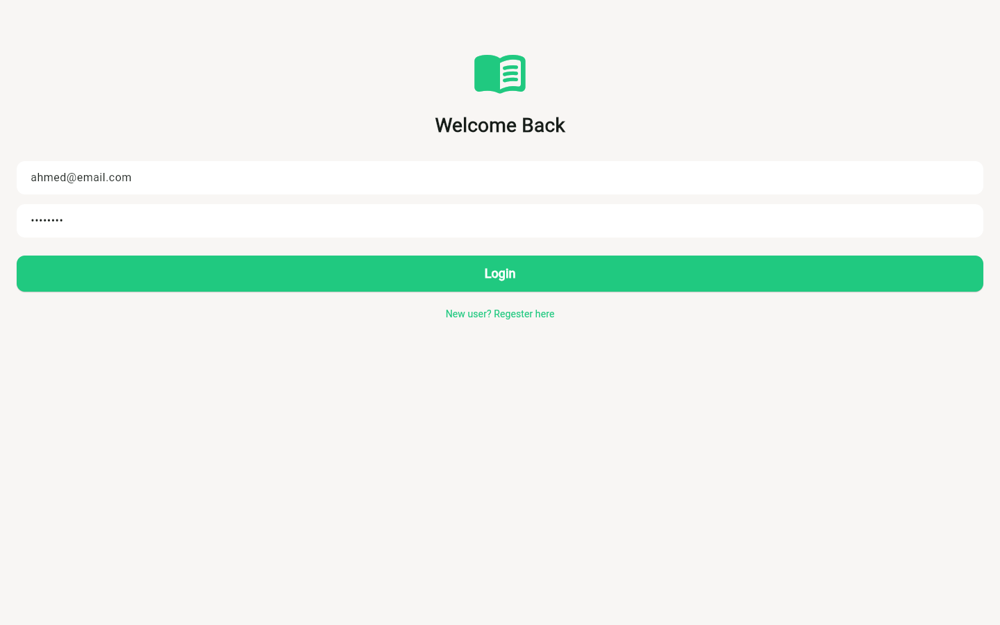
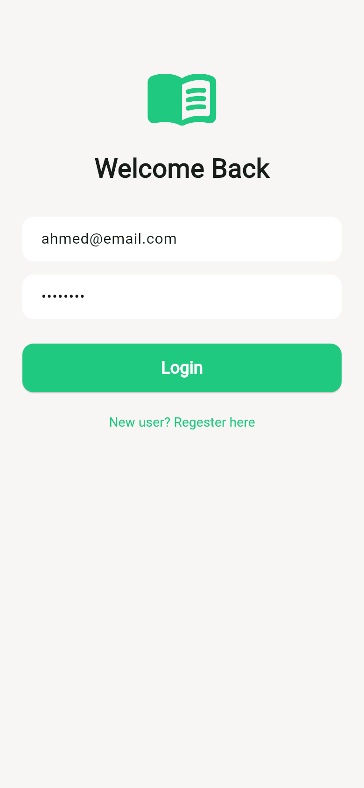

# Book Store

A Flutter bookstore app with Firebase Authentication and Cloud Firestore. The app includes book discovery and details, search, favorites, a cart, user profiles, and dashboards for publishers and store owners.

**Live web demo:** https://book-store-sw2.web.app/


| Web | Mobile |
| --- | --- |
|  |  |

## Features

- Browse and search for books, then view book details.
- Save favorite books and manage a shopping cart.
- Sign in and access a personal profile.
- Publisher and owner dashboards.
- Flutter state management with Provider.

## Tech stack

- Flutter and Dart
- Firebase Authentication
- Cloud Firestore (with security rules in `firestore.rules`)
- Firebase Hosting for the web build
- Provider
- HTTP client for API requests

## Project layout

- `lib/data/` — app data and services
- `lib/providers/` — Provider state management
- `lib/ui/pages/` — app screens
- `lib/ui/widgets/` — reusable UI
- `backend/` — backend project files

## Run locally

1. Install Flutter and configure Firebase for your target platform.
2. Fetch packages with `flutter pub get`.
3. Run the app with `flutter run` (add `-d chrome` for the web version).

The repository includes Firebase configuration files. Use your own Firebase project settings when setting up a local environment.

## Deploy the web version

```bash
flutter build web
firebase deploy --only hosting
```

## Author

**Ahmed Hebila** — Flutter & Node.js developer
[Portfolio](https://ahmedhebila.vercel.app) · [LinkedIn](https://www.linkedin.com/in/ahmed-hebila) · [GitHub](https://github.com/Ahmed-hebila)
